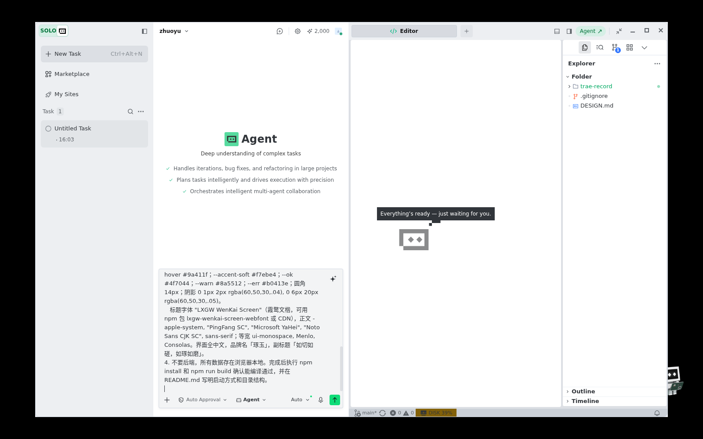
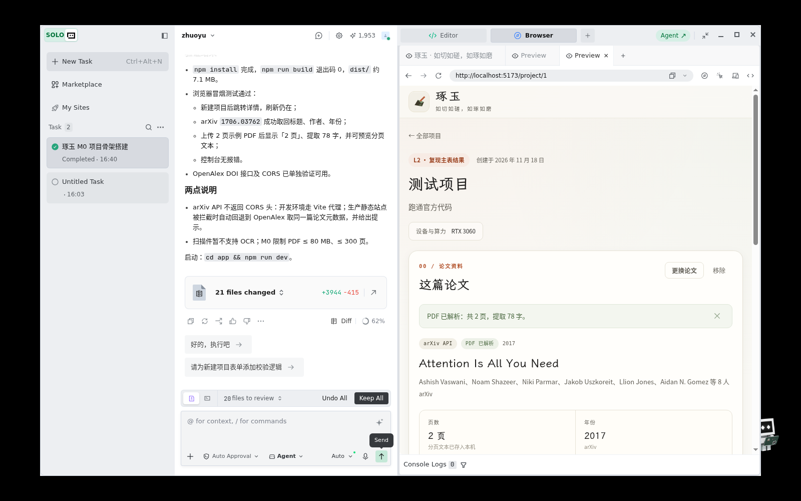
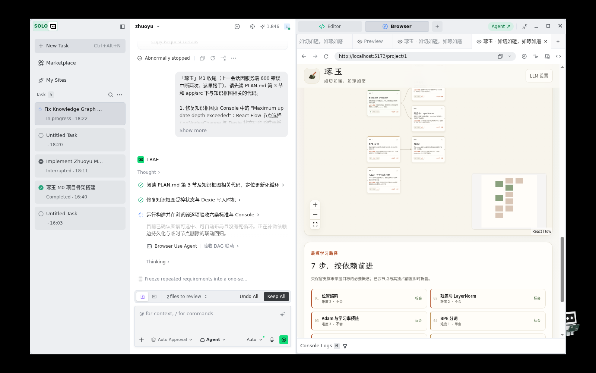
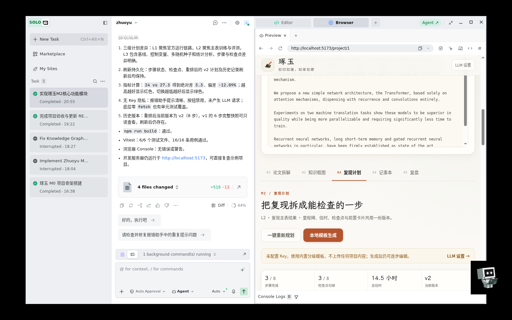
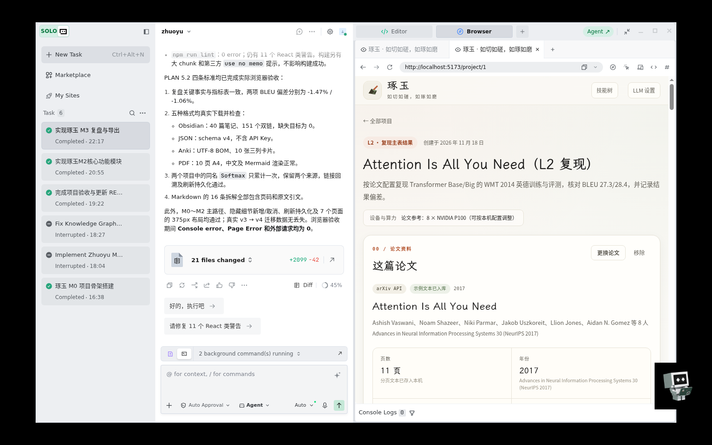
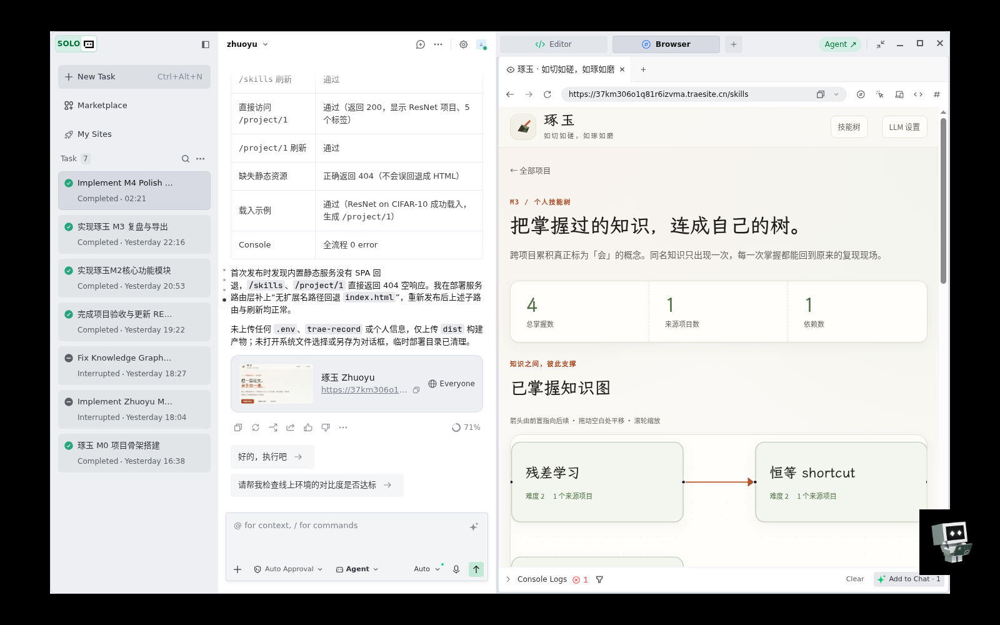

# 琢玉 Zhuoyu · 参赛材料

**琢玉：把论文亲手做一遍** —— 一个本地优先的论文复现工作台（TRAE 参赛作品）。

- **在线体验**：https://37km306o1q81r6izvma.traesite.cn
- **演示视频**（1 分 59 秒）：[demo-video.mp4](demo-video.mp4)
- **作品截图**：[images/](images/)（首页与双示例、拆解详情抽屉、知识框图、三级计划、技能树、部署上线）
- **开发过程证据**：[process/](process/)（TRAE 开发关键步骤截图，见下方「TRAE 实践过程」）

上海交通大学 · 如切如磋，如琢如磨

---

## TRAE 实践过程

琢玉全程在 **TRAE（SOLO 模式，Agent + Auto Approval）** 中以提示词驱动完成。我的做法是把每个里程碑先写成一份需求明确的提示词文档（目标、约束、验收标准都写清），TRAE 执行后按同一份标准逐项验收：构建必须通过、单元测试必须全绿、浏览器 Console 必须 0 报错，不过关就带着具体报错开修复任务继续。整个开发留有完整的过程记录：每一步的提示词、截图与 Session ID 按序号归档。

### 开发流程（里程碑）

| 阶段 | 内容 | 验收结果（节选） |
|---|---|---|
| M0 项目骨架 | 设计文档先行（DESIGN.md / PLAN.md），Vite + React + TS 脚手架、主题系统、arXiv / PDF 导入 | 21 个文件，build 通过；arXiv 元数据取回、PDF 分页解析冒烟测试通过，控制台无报错 |
| M1 论文拆解 + 知识框图 | 九类事实卡片拆解、原文引文与页码、概念依赖 DAG、最短学习路径 | 核心功能一次成型，8 条单测通过，进入浏览器逐项验收 |
| M1 收尾修复 | 修复知识框图 React Flow 受控状态死循环（Maximum update depth exceeded）与 Dexie 写入时机 | 框图联动逐项回归，Console 0 报错，build 通过 |
| M2 计划 + 记录 | L1/L2/L3 三级复现计划（可重排、带版本快照）、记事本联动、指标偏差自动计算、无 Key 报错助手 | Vitest 16/16；刷新持久化、偏差变色（24 vs 27.3 → −12.09%）等逐项验收通过 |
| M3 复盘 + 导出 + 技能树 | 结构化复盘、五种格式导出、同名概念去重沉淀 | 五种导出全部真实下载核对（Obsidian 40 篇 / 151 双链、PDF 10 页 A4、Anki 10 张卡片）；Console 与 Page Error 均为 0 |
| M4 打磨 + 双示例 | ResNet 示例、101 页 PDF 分批解析、移动端与可访问性（对比度 ≥ 4.5:1、焦点环）、lint 清零 | Vitest 35/35、lint 0、build 通过 |
| 部署上线 | 通过 TRAE 部署至 TRAE Sites | 首页、/skills、/project/1 刷新均 200，示例载入正常，Console 全流程 0 error |
| 实测修复（提示词 12） | 拆解卡片点开详情抽屉、首页一键载入示例修复 | 修复后重新部署同一站点，Console 0 error；最终 Vitest 49/49、lint 0 |

开发中也遇到过服务端中断、沙箱重启、代理凭据过期等插曲，处理方式都一样：保留现场记录、在同一任务里续接提示词、按原验收标准重新跑一遍，而不是推倒重来。

### 关键步骤截图

1. **M0：在 TRAE 中粘贴骨架提示词**（设计色板、字体、无后端与本地存储等约束都写在提示词里）

2. **M0 完成**：21 个文件变更，build 通过，TRAE 内置浏览器完成 arXiv / PDF 导入冒烟测试

3. **M1 收尾修复**：TRAE 定位并修复知识框图死循环，Browser Use Agent 逐项验收 DAG 联动，Console 0 报错

4. **M2 验收**：三级计划差异、刷新持久化、指标偏差计算、无 Key 隐私逐项通过，Vitest 16/16

5. **M3 验收**：复盘与指标表一致，五种导出真实下载核对，Console / Page Error / 外部请求均为 0

6. **部署上线**：TRAE Sites 发布后逐项核对刷新与直达链接，全流程 Console 0 error

### 关键任务 Session ID

以下为开发关键任务在 TRAE 中的会话 ID，可用于核对作品的 TRAE 开发过程：

| 任务 | Session ID |
|---|---|
| 琢玉 M0 项目骨架搭建 | `6afdd1bc651900d875a50bcf` |
| M1 论文拆解 + 知识框图 | `6afddac8651900d875a50d19` |
| M1 知识框图收尾修复（Fix Knowledge Graph） | `6afdeca2651900d875a50fda` |

### 体会

把提示词当需求文档来写、把验收当测试来跑，AI 编程就从「碰运气」变成了「可复现的工程」：每一步都知道要做什么、做没做完、证据在哪里。

---

> 说明：本仓库为参赛展示材料（视频、截图与过程证据）。开发仓库将在隐私清理后另行公开。
